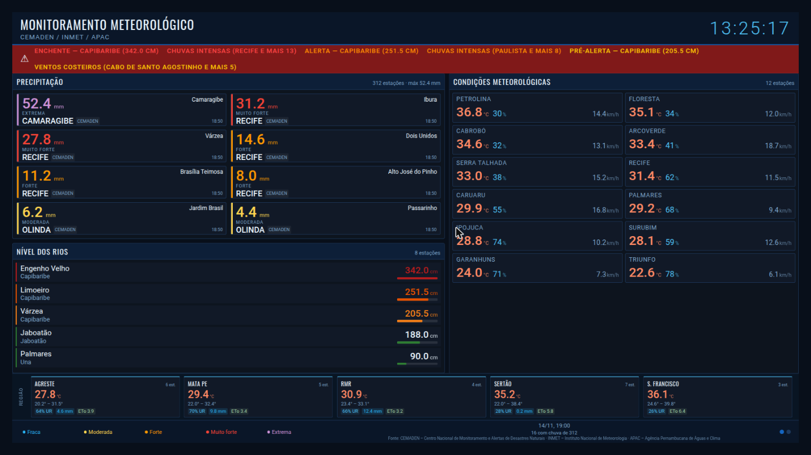
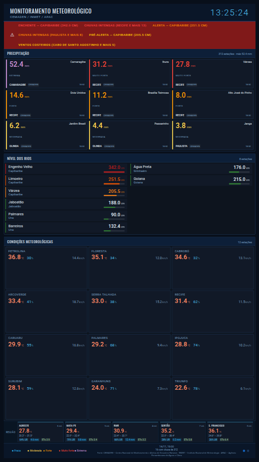
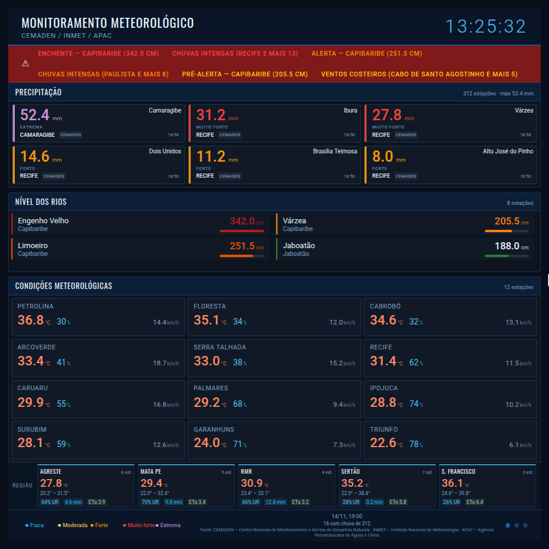
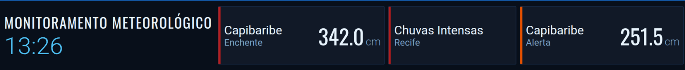
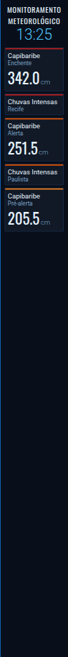

# DSPLAY - Environment Monitor Template

A [React](https://reactjs.org/) [HTML-based template](https://developers.dsplay.tv/docs/html-templates) for the [DSPLAY - Digital Signage](https://dsplay.tv/) platform, built for the **Environment Monitor** media type (`ENVIRONMENT_MONITOR`): a dashboard of the rain gauges (last hour, with intensity), river levels against the state's flood stages, current conditions of the weather stations, the weather warnings in effect and the climate of each region, for the place the media is set to.

It fetches nothing: DSPLAY's player gateway answers the media with the `environment/1` document, the player hands it to the template as `media.result` and fetches it again when it expires, so the numbers refresh without the template doing anything.

> Built with [Vite](https://vitejs.dev/), requires Node.js 22.22.2+, 24.15.0+, or 26+ (see the repository's [`.nvmrc`](https://github.com/dsplay/dsplay-templates/blob/main/.nvmrc)). Only players that speak the gateway protocol play this media type (Android 4.2.0 and later, and the web-based players).

## Supported screen formats

| Landscape | Portrait | Square |
|-----------|----------|--------|
|  |  |  |

| Horizontal banner | Vertical banner |
|--------------------|-------------------|
|  |  |

> The panels stack on a portrait or square screen (9 rain cards in portrait, 6 on a square one, which has less height). The two banner formats do not draw the panels: they rotate the most urgent items (rivers above their attention level and warnings first, then the stations raining) three at a time on the horizontal strip and five at a time in the vertical column. The screenshots are of the example data in `public/dsplay-data.js`, drawn at the real screen sizes (1920x1080, 1080x1920, 1080x1080, 1920x200, 200x1920).

## Adaptive panels

Nothing is configured for this: the template draws a panel only for the information the answer brings, so a place never shows an empty one.

| The answer has | Panel |
|----------------|-------|
| `rainfall` | Rainfall (the stations raining in the last hour; an empty list says "No rain right now") |
| `rivers` | River levels (the most serious first; as many rows as fit the format) |
| `conditions` | Weather conditions |
| `climate` (not empty) | The region bar |
| `alerts` and nothing else (the United States, Canada, Europe) | Weather alerts, as cards of their own, paged; an empty list says "No active alerts" |
| `alerts` next to other panels | In the banner at the top, with the rivers above their attention level |
| nothing | "No information for this place" |

A column with no panel is not drawn, so the other takes the whole width.

## Template variables

None. Nothing is configured on the template: the rain cards are paged by what fits the grid (8 per page, 9 on a portrait screen), the number of pages comes from the answer (the stations raining in the last hour), and every page lasts **the media's duration divided by the number of pages** (at least one second each), so the pages together last as long as the media.

## Expected media data (`media.result`)

`media.result` is the `environment/1` document. A dataset the place has no source for is **absent** (its section is not drawn); an empty list means there is nothing to report. `public/dsplay-data.js` is a complete example (Recife and Pernambuco): every field of every dataset is filled (rain of every intensity over two pages, rivers in every status, three warnings, twelve weather stations, the five mesoregions), and the build ships it as the example data the CMS preview and the screenshots use.

| Field | What the template does with it |
|-------|--------------------------------|
| `sources` | The names of the sources in the header, and each `attribution.text` as the credit line in the footer |
| `rainfall[]` | Rain cards: `last1hMm` and `intensity` (`light`, `moderate`, `heavy`, `very_heavy`, `extreme`), `name`, `city`, `operator`, `observedAt`; stations with no rain in the last hour are not drawn. `summary.rainfall` feeds the section and the footer |
| `rivers[]` | River cards: `levelCm` against `thresholds` (`attention`, `alert`, `flood`), `status` |
| `alerts[]` | With the rivers above their attention level, the banner at the top: `event`, `severity`, `areas`, `areaCount` |
| `conditions[]` | Current conditions: `temperatureC`, `humidityPct`, `windKmh` |
| `climate[]` | The region bar: temperatures now and extremes, humidity, rain and ETo accumulated since `windowStart` |
| `generatedAt`, `unavailable[]` | The footer's last update, or "Atualização parcial" when a dataset failed this time |

The template's own text is in English, Portuguese, Spanish, Italian, German and Dutch, picked from the player's language (`dsplay_config.locale`); what the answer carries (a warning's event, the stations' names) is shown as the source wrote it.

## Local development

This template lives in the [dsplay-templates monorepo](https://github.com/dsplay/dsplay-templates/blob/main/README.md); install from the repository root, then:

```sh
npm start
```

`public/dsplay-data.js` defines the `dsplay_config`/`dsplay_media`/`dsplay_template` mock globals used only outside the DSPLAY app; edit `dsplay_media.result` to try other answers (an absent dataset, a failed one). The DSPLAY Player App replaces the file with the real content at runtime.

## For developers

| To change | Edit |
|-----------|------|
| The loader animation (a cloud and falling drops, inline SVG) | `src/components/intro` |
| Text and translations (every key is its English text; all six languages must map all keys, a test checks it) | `src/i18n.js` |
| Colours and the rain intensity classes | `src/components/main/style.sass` |
| What an answer becomes on screen (paging, banner, river bars) | `src/components/main/model.js` |

### Test assets

To use test assets (images, videos, etc) during development, put them in the `public/test-assets` folder and reference them in `public/dsplay-data.js`; the folder is excluded from the release build.

### Packing (release build)

```sh
npm run zip
```

Builds with Vite (which also writes `template-variables.json` and `template-example-data.json` through [@dsplay/template-manifest](https://www.npmjs.com/package/@dsplay/template-manifest)'s plugin) and zips `build/` into `template.zip`. Upload it to the [DSPLAY Web Manager](https://manager.dsplay.tv/template/create) as a template of type `EnvironmentMonitor`.

### Maintaining dependencies

Dependencies are pinned to exact versions; see [AGENTS.md](AGENTS.md).

## More

To see more about DSPLAY HTML Templates, visit: https://developers.dsplay.tv/docs/html-templates

To work on this template together with the others (shared libraries, creating a new template from an existing one, releases), see the [repository README](https://github.com/dsplay/dsplay-templates/blob/main/README.md).
