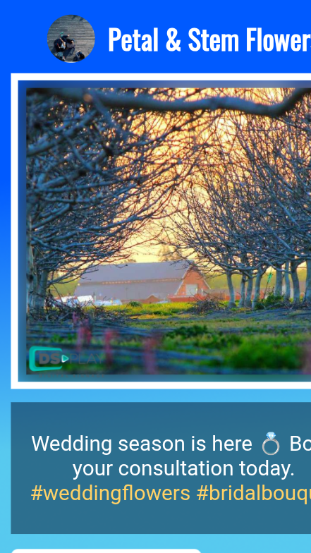
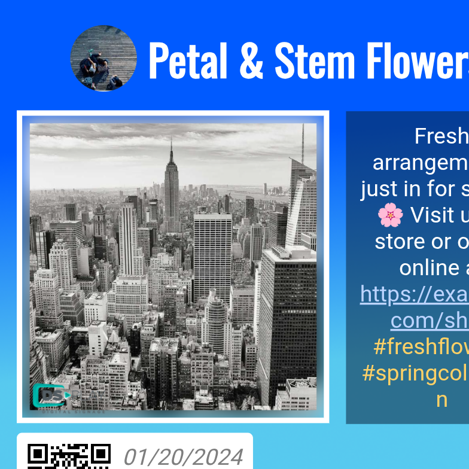
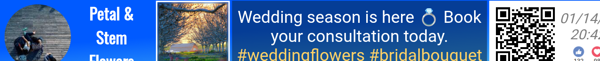

# DSPLAY - Facebook Posts Template

A [React](https://reactjs.org/) [HTML-based template](https://developers.dsplay.tv/docs/html-templates) for the [DSPLAY - Digital Signage](https://dsplay.tv/) platform — cycles through a Facebook page's recent posts (text, reactions, photos/videos), with a QR code linking back to each post.

> Built with [Vite](https://vitejs.dev/), requires Node.js 22.22.2+, 24.15.0+, or 26+ (see the repository's [`.nvmrc`](https://github.com/dsplay/dsplay-templates/blob/main/.nvmrc)).

## Supported screen formats

Layout adapts to landscape, portrait, square, and horizontal-banner screen formats — the user profile, media, and QR code/reactions panel rearrange accordingly.

| Landscape | Portrait | Square |
|-----------|----------|--------|
|  |  |  |

| Horizontal banner |
|--------------------|
|  |

## Template variables

| Key                    | Type    | Default             | Description                                                                                  |
|------------------------|---------|----------------------|------------------------------------------------------------------------------------------------|
| `show_logo`            | boolean | `true`               | Shows a small DSPLAY-style logo overlay in the bottom-right corner.                            |
| `bg_horizontal`        | string  | —                    | Background image for landscape/square/banner formats.                                          |
| `bg_vertical`          | string  | `bg_horizontal`      | Background image for portrait format. Falls back to `bg_horizontal` when unset.                |
| `primary_color`        | string  | `white`              | Default color for the user's display name.                                                     |
| `user_full_name_color` | string  | `primary_color`      | Overrides the user's display name color specifically.                                          |
| `color_1`              | string  | `#fff`                | Base color, used as the default for `text_color`/`border_color`.                                |
| `color_2`              | string  | `#fd4`                | Base color, used as the default for `hashtag_color`/`mention_color`/`phone_color`.               |
| `color_3`              | string  | `#b9d0ff`              | Base color, used as the default for `link_color`.                                              |
| `color_4`              | string  | `#000`                | Base color, used as the default for `text_bg_color`.                                            |
| `text_color`           | string  | `color_1`             | Post text color.                                                                                |
| `border_color`         | string  | `color_1`             | Border color around the media slider.                                                          |
| `hashtag_color`        | string  | `color_2`             | Color applied to `#hashtags` found in post text.                                                |
| `mention_color`        | string  | `color_2`             | Color applied to `@mentions` found in post text.                                                |
| `phone_color`          | string  | `color_2`             | Color applied to phone numbers found in post text.                                              |
| `link_color`           | string  | `color_3`             | Color applied to `http(s)://` links found in post text.                                         |
| `text_bg_color`        | string  | `color_4`             | Background color behind post text (only shown for posts that have text).                        |
| `text_bg_opacity`      | float   | `0.3`                 | Opacity of `text_bg_color`.                                                                     |
| `overlay`              | string  | —                    | Optional image overlaid on each media item (e.g. a badge or watermark).                          |
| `overlay_position`     | string  | `bottom-left`          | Position of `overlay` — one of `top-left`, `top-right`, `bottom-left`, `bottom-right`, `center`.  |
| `image_fit`            | string  | `contain`              | How media fills its slot — one of `contain`, `cover`, `stretch`.                                 |

> Remember to also register these as Template Vars (same name and type) when configuring this template in the DSPLAY CMS.
> New variable names should use `snake_case` (e.g. `background_color`, not `backgroundColor`) — the DSPLAY CMS Manager auto-generates each variable's label from its key, and snake_case reads more naturally there.

## Local development

This template lives in the [dsplay-templates monorepo](https://github.com/dsplay/dsplay-templates/blob/main/README.md): install and run it from the **repository root**. The dev server builds the shared `@dsplay/*` libraries first, which a bare `npm start` inside this folder does not, and `npm install` run inside this folder only installs this template's own packages, not the repository tooling (Turborepo) that does that build.

```sh
npm install                       # once
npm start -- --filter=dsplay-template-facebook-posts
```

`public/dsplay-data.js` defines `dsplay_config`/`dsplay_media`/`dsplay_template` mock globals used only when the template isn't running inside the actual DSPLAY app. `dsplay_media.result.data` holds the mock Facebook `user`/`posts` payload — edit it to try out different posts, reaction counts, or media. The DSPLAY Player App replaces it with real content at runtime.

## Test assets

To use test assets (images, videos, etc) during development, put them in the `public/test-assets` folder and reference them in `dsplay-data.js` using their relative path. `public/test-assets` is automatically excluded from the release build.

## Packing (release build)

```sh
npm run zip -- --filter=./templates/facebook-posts   # from the repository root
```

`template.zip` is written to this folder (`templates/facebook-posts/template.zip`). The **Package templates** GitHub workflow builds it too (Actions tab, then download the artifact), so you can get it without a local build.

This builds the template with Vite, which also generates `template-variables.json` + `template-example-data.json` (via [@dsplay/template-manifest](https://www.npmjs.com/package/@dsplay/template-manifest)'s Vite plugin) — the DSPLAY CMS reads these two files to auto-detect this template's variables and seed default preview values. It then generates `template.zip`, ready to be deployed to the [DSPLAY Web Manager](https://manager.dsplay.tv/template/create).

## Maintaining dependencies

**Dependencies must always be pinned to an exact version** (never `^`, `~` or any other range). The repository's root [`.npmrc`](https://github.com/dsplay/dsplay-templates/blob/main/.npmrc) sets `save-exact=true`, so `npm install <pkg>@<version>` pins automatically. It also disables dependency install scripts (`ignore-scripts=true`) and only accepts package versions published at least 3 days ago (`min-release-age=3`), to reduce supply chain risk. None of the current dependencies need a post-install build step; if one ever does, add a `setup` script to `package.json` (`npm install && npm rebuild <package>`) and document it here.

[Dependabot](https://github.com/dsplay/dsplay-templates/blob/main/.github/dependabot.yml) proposes updates weekly, waiting 3 days after a release (7 days for major versions) before opening a PR.

```sh
npm outdated                  # from the repository root: what has newer versions available
npm install <dependency>@<version> -w dsplay-template-facebook-posts   # bump a dependency of this template (stays pinned)
```

Since versions are pinned, `npm update` does nothing; bump each package explicitly (or merge Dependabot's PRs). For a major bump, verify `npm start -- --filter=dsplay-template-facebook-posts` and `npx turbo run build test --filter=dsplay-template-facebook-posts` (from the repository root) still work before committing.

### Commit conventions

See [AGENTS.md](AGENTS.md).

## More

To see more about DSPLAY HTML Templates, visit: https://developers.dsplay.tv/docs/html-templates

To work on this template together with the others (shared libraries, creating a new template from an existing one, releases), see the [repository README](https://github.com/dsplay/dsplay-templates/blob/main/README.md).
