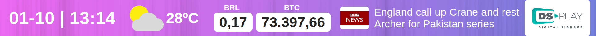
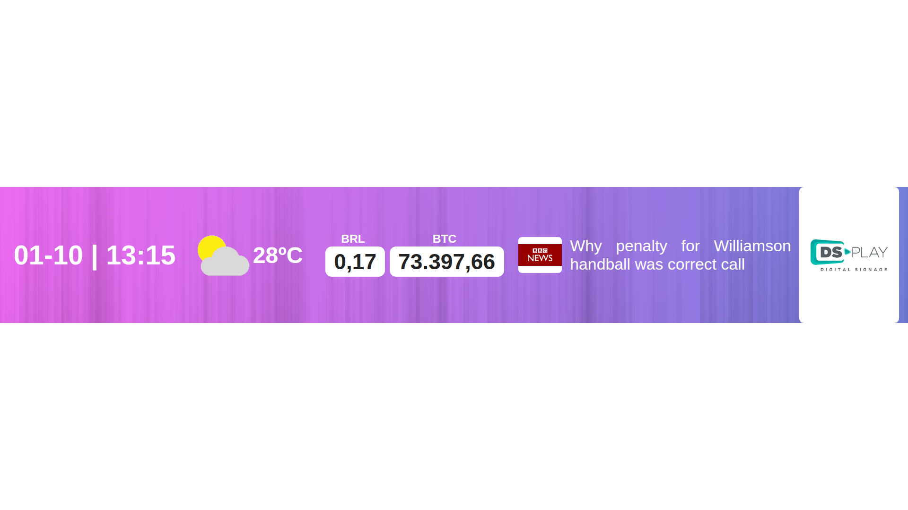
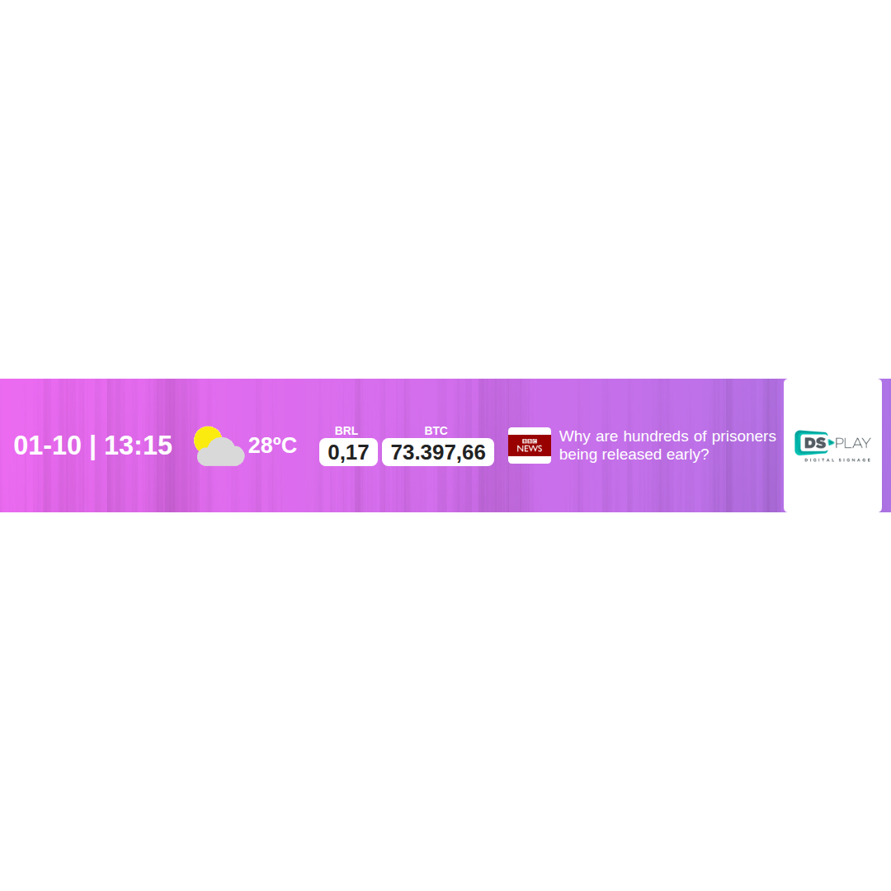

# DSPLAY - Horizontal Information Bar

A [React](https://reactjs.org/) [HTML-based template](https://developers.dsplay.tv/docs/html-templates) for the [DSPLAY - Digital Signage](https://dsplay.tv/) platform — a horizontal bar with up to five independent, optional widgets: clock, weather, currency quotes, RSS news, and a sponsor logo.

> Built with [Vite](https://vitejs.dev/), requires Node.js 22.22.2+, 24.15.0+, or 26+ (see the repository's [`.nvmrc`](https://github.com/dsplay/dsplay-templates/blob/main/.nvmrc)).

## Features

- **Clock** — local time, formatted for the configured locale.
- **Weather** — current temperature and condition icon for a given latitude/longitude.
- **Currency quotes** — converts two source currencies into a target currency.
- **News** — one random headline from an RSS feed, refreshed periodically.
- **Sponsor** — a single logo image.

Every widget is independently optional — it only renders once its required variable(s) are set (see the table below for which ones, per widget). `widgets_sequence_query` controls the *order* widgets appear in — it does **not** control which widgets are shown; a widget left out of it still appears, just last.

## Supported screen formats

The widgets are always laid out in a single thin horizontal row. If the container itself is already a thin banner, the bar simply fills it. If the container is landscape or square instead — e.g. the template set to fill the whole screen — the bar caps its own height proportionally to the screen's width and centers itself, rather than stretching its background across the full height. Portrait containers aren't a good fit: the widgets aren't designed to re-lay out vertically.

| Horizontal banner | Landscape (full screen) | Square (full screen) |
|---------------------|----------------------------|-------------------------|
|  |  |  |

## Template variables

| Key                     | Type    | Description                                                                                     |
|--------------------------|---------|---------------------------------------------------------------------------------------------------|
| `clock`                 | boolean | Enables/disables the Clock widget. Defaults to `true`.                                          |
| `latitude`              | string  | Latitude of the place to get weather for, e.g. `41.1621376`. Weather widget is hidden if unset.  |
| `longitude`             | string  | Longitude of the place to get weather for, e.g. `-8.656973`. Weather widget is hidden if unset.  |
| `weather_unit`          | string  | Temperature unit shown in the Weather widget: `Celsius` or `Fahrenheit`. Defaults to `Celsius`.  |
| `source_currency_1`     | string  | First source currency to convert, e.g. `BRL`, `USD`, `EUR`. Currency quotes widget is hidden unless this, `source_currency_2`, and `target_currency` are **all** set. |
| `source_currency_2`     | string  | Second source currency to convert. See `source_currency_1`.                                     |
| `target_currency`       | string  | Target currency both source currencies are converted to. See `source_currency_1`.                |
| `rss_url`               | string  | RSS feed URL. Leave empty to hide the News widget.                                               |
| `rss_logo_box_color`    | color   | Background color behind the feed's channel image.                                               |
| `sponsor_logo`          | image   | Logo shown in the Sponsor widget. Leave empty to hide it.                                        |
| `sponsor_logo_box_color`| color   | Background color behind the sponsor logo.                                                        |
| `widgets_sequence_query`| string  | Display order of widgets (does not hide any) — see [Widget sequence syntax](#widget-sequence-syntax) below. |
| `bg_color`              | color   | Background color of the whole bar. Defaults to `white`.                                         |
| `bg_image`              | image   | Background image of the whole bar.                                                              |
| `text_color`            | color   | Text color of the whole bar. Defaults to `black`.                                               |
| `currency_box_color`    | color   | Background color behind each currency value.                                                    |
| `currency_text_color`   | color   | Text color of each currency value.                                                               |

> Remember to also register these as Template Vars (same name and type) when configuring this template in the DSPLAY CMS.
> New variable names should use `snake_case` (e.g. `background_color`, not `backgroundColor`) — the DSPLAY CMS Manager auto-generates each variable's label from its key, and snake_case reads more naturally there.

### Widget sequence syntax

`widgets_sequence_query` is a comma-separated list of single-character widget codes controlling the order widgets are displayed in. It does **not** hide any widget — to hide a widget, unset its own required variable(s) instead (see the table above: `clock` for the Clock widget, `latitude`/`longitude` for Weather, `source_currency_1`/`source_currency_2`/`target_currency` for Currency quotes, `rss_url` for News, `sponsor_logo` for Sponsor).

| Character | Widget          |
|-----------|-----------------|
| `c`       | Clock           |
| `w`       | Weather         |
| `q`       | Currency quotes |
| `n`       | News            |
| `s`       | Sponsor         |

E.g. `"s,c,w,n,q"`. Defaults to `"s,w,q,n,c"`. Unknown characters are ignored; any widget code left out still appears, appended after the ones you listed.

## Local development

This template lives in the [dsplay-templates monorepo](https://github.com/dsplay/dsplay-templates/blob/main/README.md): install and run it from the **repository root**. The dev server builds the shared `@dsplay/*` libraries first, which a bare `npm start` inside this folder does not, and `npm install` run inside this folder only installs this template's own packages, not the repository tooling (Turborepo) that does that build.

```sh
npm install                       # once
npm start -- --filter=dsplay-template-horizontal-info-bar
```

`public/dsplay-data.js` defines `dsplay_config`/`dsplay_media`/`dsplay_template` mock globals used only when the template isn't running inside the actual DSPLAY app. Edit it to try out different values — the DSPLAY Player App replaces it with real content at runtime.

## Packing (release build)

```sh
npm run zip -- --filter=./templates/horizontal-info-bar   # from the repository root
```

`template.zip` is written to this folder (`templates/horizontal-info-bar/template.zip`). The **Package templates** GitHub workflow builds it too (Actions tab, then download the artifact), so you can get it without a local build.

This builds the template with Vite, which also generates `template-variables.json` + `template-example-data.json` (via [@dsplay/template-manifest](https://www.npmjs.com/package/@dsplay/template-manifest)'s Vite plugin) — the DSPLAY CMS reads these two files to auto-detect this template's variables and seed default preview values. It then generates `template.zip`, ready to be deployed to the [DSPLAY Web Manager](https://manager.dsplay.tv/template/create).

Works the same on Windows, macOS and Linux — packing is a plain Node script (`scripts/pack.mjs`), no shell script or system `zip` tool required.

## Maintaining dependencies

**Dependencies must always be pinned to an exact version** (never `^`, `~` or any other range). The repository's root [`.npmrc`](https://github.com/dsplay/dsplay-templates/blob/main/.npmrc) sets `save-exact=true`, so `npm install <pkg>@<version>` pins automatically. It also disables dependency install scripts (`ignore-scripts=true`) and only accepts package versions published at least 3 days ago (`min-release-age=3`), to reduce supply chain risk. None of the current dependencies need a post-install build step; if one ever does, add a `setup` script to `package.json` (`npm install && npm rebuild <package>`) and document it here.

[Dependabot](https://github.com/dsplay/dsplay-templates/blob/main/.github/dependabot.yml) proposes updates weekly, waiting 3 days after a release (7 days for major versions) before opening a PR.

```sh
npm outdated                  # from the repository root: what has newer versions available
npm install <dependency>@<version> -w dsplay-template-horizontal-info-bar   # bump a dependency of this template (stays pinned)
```

Since versions are pinned, `npm update` does nothing; bump each package explicitly (or merge Dependabot's PRs). For a major bump, verify `npm start -- --filter=dsplay-template-horizontal-info-bar` and `npx turbo run build test --filter=dsplay-template-horizontal-info-bar` (from the repository root) still work before committing.

### Commit conventions

See [AGENTS.md](AGENTS.md).

## More

To see more about DSPLAY HTML Templates, visit: https://developers.dsplay.tv/docs/html-templates

To work on this template together with the others (shared libraries, creating a new template from an existing one, releases), see the [repository README](https://github.com/dsplay/dsplay-templates/blob/main/README.md).
