# DSPLAY - Daily Horoscope Templates

Eight [React](https://reactjs.org/) [HTML-based templates](https://developers.dsplay.tv/docs/html-templates) for the [DSPLAY - Digital Signage](https://dsplay.tv/) platform, all for the **Daily Horoscope** media type. One package, one set of logic, eight looks: each style is built into its own zip and becomes its own system template in the CMS.

It fetches nothing and holds no key: DSPLAY's player gateway answers the media with the `horoscope/1` document (written by AI, once a day), the player hands it to the template as `media.result` and the template only draws it.

> Built with [Vite](https://vitejs.dev/), requires Node.js 22.22.2+, 24.15.0+, or 26+. Only players that speak the gateway protocol play this media type.

## The answer (`horoscope/1`)

```jsonc
{
  "schema": "horoscope/1", "date": "2026-11-15", "lang": "pt", "generatedAt": "2026-11-15T00:05:00Z",
  "signs": [ // 12, in zodiac order
    {
      "sign": "aries",              // aries taurus gemini cancer leo virgo libra scorpio sagittarius capricorn aquarius pisces
      "from": "03-21", "to": "04-19", // MM-DD
      "element": "fire",            // fire earth air water
      "keyword": "Iniciativa",      // a short word, in `lang`
      "text": "Um convite inesperado ...", // two sentences, in `lang`
      "love": 4, "work": 5, "health": 3,   // 1 to 5
      "luckyNumber": 9,
      "luckyColor": "red",          // red orange yellow green teal blue purple pink white gold
      "compatible": "leo"           // another sign
    }
  ],
  "sources": [{ "text": "Horoscope written by AI for entertainment", "url": "https://dsplay.tv", "license": "..." }]
}
```

What the answer does not carry is the template's own text, in the screen's language (`dsplay_config.locale`): the sign names, the dates (`21 mar`, `Mar 21`, `21. Mär`), the labels (Love, Work, Health, Lucky number, Colour, Matches with), the element and colour names and the disclaimer. English, Portuguese, Spanish, French, German and Italian. The keyword and the text of a sign stay in the language of the answer. The date in the header is the player's own date, written in the screen's language.

A sign with no text or an unknown id is dropped; a missing date or element comes from the zodiac table; a score outside 1 to 5 is clamped; an unknown lucky colour or match is left out of the screen (`readSigns` in `src/lib/model.js`). An answer with no usable sign shows one centered message.

## Which sign is shown

`useMedia()` gives the media's `iteration` (how many times it was played) and `result`:

- one sign a screen: `signs[iteration % 12]`;
- **Duo**: two signs a screen, pair `iteration % 6` is signs `2p` and `2p + 1` (six screens for the twelve signs).

## The styles

| Style (CMS name) | Zip | What it is |
|---|---|---|
| Starry Sky | `zips/horoscope-starry-sky.zip` | One sign on a night sky with its constellation; the portrait layout adds the strip of the twelve signs |
| Duo | `zips/horoscope-duo.zip` | Two signs side by side (one above the other in portrait), with the page marker |
| Daylight | `zips/horoscope-daylight.zip` | Light warm theme, gradient tile, scores in a card, the twelve signs as tiles |
| Golden Age | `zips/horoscope-golden-age.zip` | Gold-on-black art deco frame, constellation in a ring, scores as stars |
| Candy | `zips/horoscope-candy.zip` | Pastel colours by element, a big glyph in a blob, scores as pills |
| Neon Nights | `zips/horoscope-neon-nights.zip` | Synthwave night, glowing name, neon constellation, scores as light bars |
| Gazette | `zips/horoscope-gazette.zip` | A newspaper page: serif type, ink glyph, red constellation stamp, scores as rules |
| Spectrum | `zips/horoscope-spectrum.zip` | Bold full-colour screen by element with a huge name and bars |

All eight are CMS type **Daily Horoscope**. The name and description of each (`src/styles.js`) are written next to its zip as `zips/horoscope-<style>.json` when it is built: the zip itself carries no name or type (the manifest plugin only writes `template-variables.json` and `template-example-data.json`), so type those in the CMS when creating the system template.

### Screen formats

Every style has a landscape (1280 x 720), a portrait (720 x 1280), a square (900 x 900) and its own horizontal and vertical **banner** layout, picked from `useScreenInfo().screenFormat`. Each layout is drawn on a **plate** in design pixels and scaled to the screen (`Stage`: the root font size is set so that `u(96)` in the stylesheets is 96 design pixels); a screen of another shape (1366 x 768, 1280 x 1024, 1920 x 1200...) gets bars of the style's background round the plate. A text always fits its box: `fitFont` (`src/lib/layout.js`) takes the biggest size that fits, down to a minimum, and the box clips beyond that.

A banner plate is not a fixed size: it is 240 design pixels thick and as long as the screen asks (`plateOf(format, width, height)`: 960 for a 4:1 strip, 2400 for 10:1, up to 3000), so a 1920 x 300 or a 3000 x 300 strip is always filled and the text boxes grow with it. On a short strip the constellation and the scores are left out; the notice stays. The horizontal banner is one row (sign, name and dates, text, then the scores and the lucky number); the vertical one is a narrow column in the same order with the notice at the bottom. Each style draws them in its own way:

| Style | Horizontal banner (1920 x 300) | Vertical banner (300 x 1920) |
|---|---|---|
| Starry Sky | 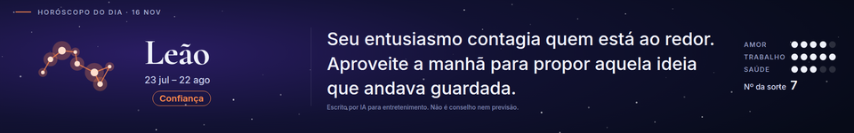 | 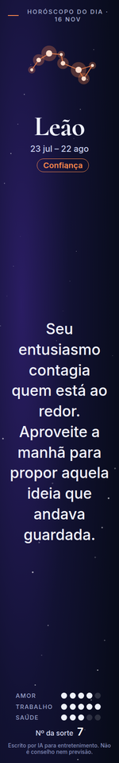 |
| Duo |  | 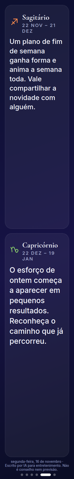 |
| Daylight | 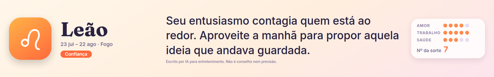 | 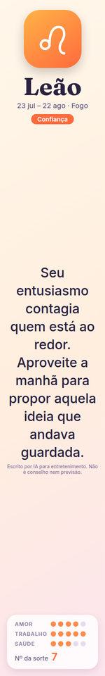 |
| Golden Age | 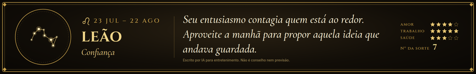 | 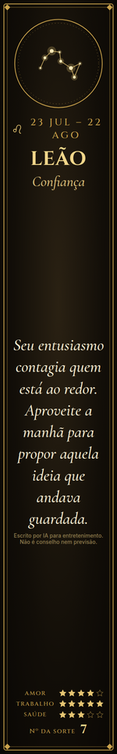 |
| Candy | 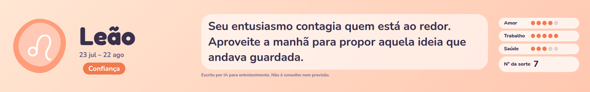 | 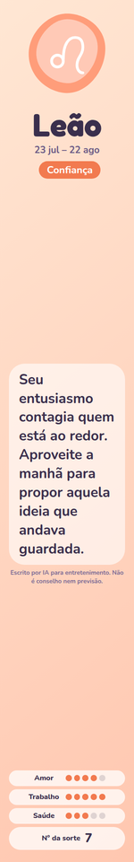 |
| Neon Nights | 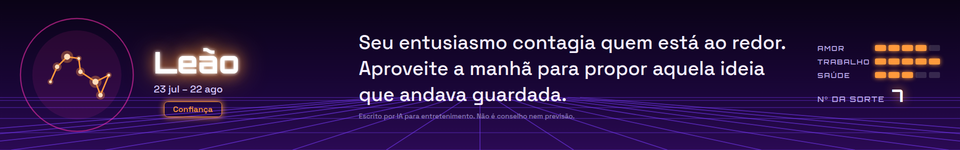 | 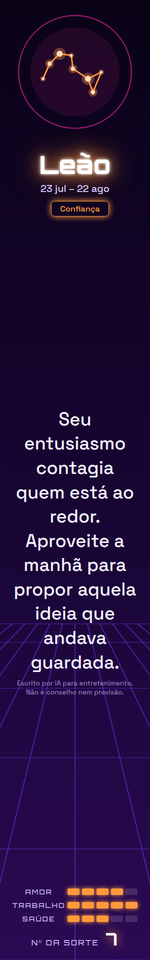 |
| Gazette | 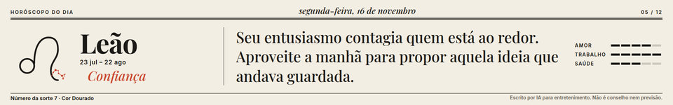 | 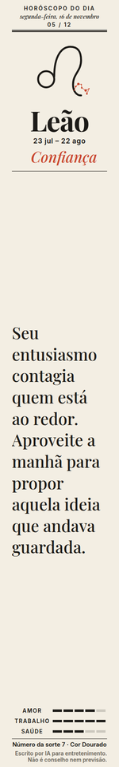 |
| Spectrum |  |  |

## Local development

This template lives in the [dsplay-templates monorepo](https://github.com/dsplay/dsplay-templates/blob/main/README.md); install from the repository root, then, in `templates/horoscope`:

```sh
npm start                  # the first style (Starry Sky), http://localhost:3000
npm start -- golden-age    # any style by its id
PORT=3100 npm start -- neon-nights
```

`public/dsplay-data.js` defines the `dsplay_config`/`dsplay_media` mock used only outside the DSPLAY app, with a full example answer. Add to the address:

| Parameter | Does |
|---|---|
| `?iteration=7` | the sign (or pair, for Duo) of the 8th play |
| `?locale=en` | the template's language (`es`, `fr`, `de`, `it`, `pt_br`) |
| `?long=6` | every text six times longer: to check that a long text shrinks and never overflows |

To see any screen size open `/test-assets/format.html?w=1920&h=1080` (a dev-only harness that passes the other parameters on; left out of the release build).

## Build the zips

```sh
npm run zip:all     # lint, then every style one after the other: zips/horoscope-<style>.zip + .json
npm run build       # one style into build/ (TEMPLATE_STYLE=golden-age via: node scripts/run.mjs build golden-age)
node scripts/run.mjs zip candy    # one style's zip
```

The style is chosen at build time (`TEMPLATE_STYLE`, wired in `vite.config.js` to the `@style` alias), so each zip holds only its own code and fonts. `zips/` and `build/` are git-ignored.

## Old Android WebViews

The players run Android 4.4 WebViews (Chrome 30) in the legacy bundle, so: no CSS custom properties (Sass variables), no `display: grid` and no flex `gap` (flexbox and margins), no `clamp()`/`min()`, no `paint-order` (lettering outlines are `text-shadow`s), `-webkit-` mixins for transforms and animations, and **no CSS animation on SVG elements**: only HTML boxes move (the loader's wheel is a `div` round static SVG glyphs); the constellations, glyphs and frames are static SVG.

## Fonts

Bundled, never fetched: `src/assets/font` (`woff2` + `woff`, latin subset, from the [Fontsource](https://fontsource.org/) 5.3.0 packages of the Google Fonts families, SIL Open Font License 1.1, licenses in `src/assets/font/licenses`). Each style's `fonts.sass` declares only its own: Starry Sky and Duo Cormorant Garamond + Inter; Daylight Fraunces + Inter; Golden Age Cinzel + Cormorant Garamond italic + Inter; Candy Nunito + Fredoka; Neon Nights Orbitron + Space Grotesk; Gazette Playfair Display + Inter; Spectrum Poppins. These are the fonts of the mockups, so no substitution was needed. Latin only: other scripts fall back to the system font.

## For developers

| To change | Edit |
|---|---|
| What an answer becomes (order, defaults, which sign, dates) | `src/lib/model.js` |
| Text and translations (every key is its English text; a test checks the six languages and that every key is used) | `src/i18n.js`, `src/lib/labels.js` |
| The plate sizes and the text fitting | `src/lib/layout.js` |
| A style | `src/styles/<id>/` (`index.jsx`, `style.sass`, `fonts.sass`); register a new one in `src/styles.js` |
| The loader | `src/components/intro` |

Dependencies are pinned to exact versions; see [AGENTS.md](AGENTS.md).
