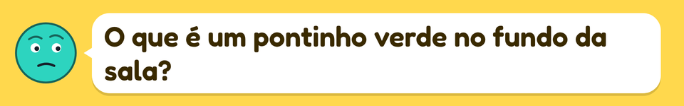
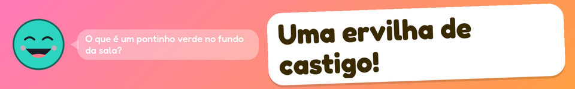
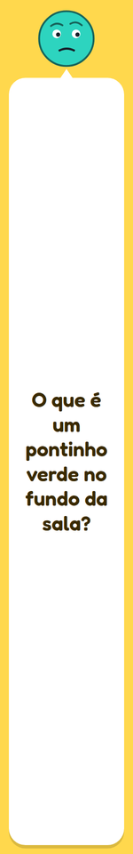
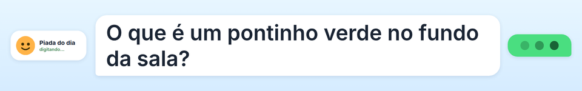
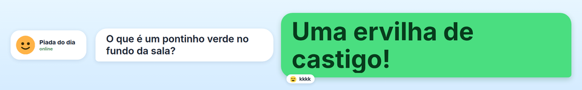
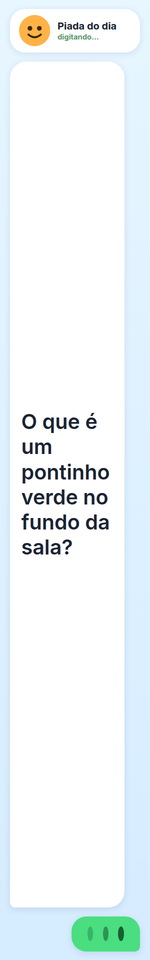
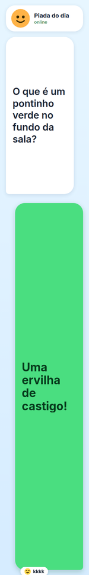
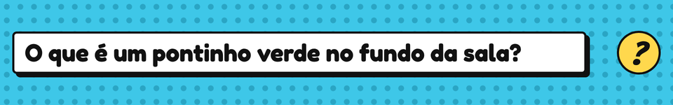
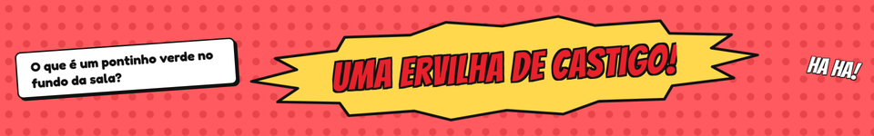
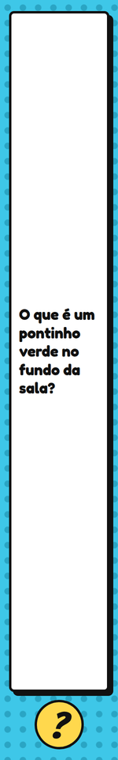

# DSPLAY - Jokes Templates

Four [React](https://reactjs.org/) [HTML-based templates](https://developers.dsplay.tv/docs/html-templates) for the [DSPLAY - Digital Signage](https://dsplay.tv/) platform, all for the **Jokes** media type. One package, one set of logic, four looks: each style is built into its own zip and becomes its own system template in the CMS.

It fetches nothing and holds no key: DSPLAY's player gateway answers the media with the `jokes/1` document (written by AI), the player hands it to the template as `media.result` and the template only draws it.

> Built with [Vite](https://vitejs.dev/), requires Node.js 22.22.2+, 24.15.0+, or 26+. Only players that speak the gateway protocol play this media type.

## The answer (`jokes/1`)

```jsonc
{
  "schema": "jokes/1", "lang": "pt", "date": "2026-11-15", "generatedAt": "2026-11-15T00:05:00Z",
  "jokes": [ // a pool of 10 to 40
    { "id": "2026-11-15-pt-07", "setup": "the question", "punchline": "the answer" }
  ],
  "sources": [{ "text": "Jokes written by AI", "url": "https://dsplay.tv", "license": null }]
}
```

The joke is `jokes[iteration % jokes.length]` (`iteration`: how many times the media was played). A joke with no question or no answer is dropped. An answer with no usable joke shows one centered message. The words around the joke (Question, Answer, Joke of the day, typing..., online, now, haha, HA HA!) are the template's own, in the screen's language: English, Portuguese, Spanish, French, German and Italian; the joke itself stays in the answer's language.

## How a joke plays

The **question** is alone on screen for `questionMs = clamp(round(duration * 0.45), 3000, 9000)` (`duration` is how long the media stays on screen, in ms). Then the **answer** pops in (a CSS animation of HTML boxes: opacity and transform keyframes) and stays until the media ends; the question stays visible, smaller. A long question or answer shrinks to fit its box (`fitFont` in `src/lib/layout.js`), and the box clips beyond the minimum size.

## The styles

| Style (CMS name) | Zip | What it is |
|---|---|---|
| Speech Bubbles | `zips/jokes-speech-bubbles.zip` | Yellow screen and a big white speech bubble; the answer pops into a second bubble on pink and orange |
| Game Show | `zips/jokes-game-show.zip` | Blue quiz stage, the question on a card, the answer on a yellow card with confetti |
| Chat | `zips/jokes-chat.zip` | A messaging screen: the question arrives while "typing...", the answer comes back as a green reply with a laugh reaction |
| Comic | `zips/jokes-comic.zip` | Halftone comic page, a boxed question, the answer in an outlined burst with a "HA HA!" |

All four are CMS type **Jokes**. The name and description of each (`src/styles.js`) are written next to its zip as `zips/jokes-<style>.json` when it is built: the zip itself carries no name or type (the manifest plugin only writes `template-variables.json` and `template-example-data.json`), so type those in the CMS when creating the system template.

### Screen formats

Every style has a landscape (1280 x 720), a portrait (720 x 1280), a square (900 x 900) and its own horizontal and vertical **banner** layout, picked from `useScreenInfo().screenFormat`. Each layout is drawn on a plate in design pixels and scaled to the screen (`Stage`); a screen of another shape gets bars of the style's background round the plate. The drawings were made for a 660 x 371 stage: `m(n)` in the Sass is such a pixel on the landscape plate (1.94 design px).

A banner plate is not a fixed size: it is 240 design pixels thick and as long as the screen asks (`plateOf(format, width, height)`: 960 for a 4:1 strip, 2400 for 10:1, up to 3000), so a 1920 x 300 or a 3000 x 300 strip is always filled. On a banner the question comes first and takes the whole strip; when the answer is revealed the question shrinks (to a chip, a label or a small card, depending on the style) and the answer pops in beside it (below it on a vertical banner). Each style draws it in its own way (the question, then the answer):

| Style | Horizontal banner, 1920 x 300 | Vertical banner, 300 x 1920 |
|---|---|---|
| Speech Bubbles | <br> |   |
| Game Show | <br> |   |
| Chat | <br> |   |
| Comic | <br> |   |

## Local development

This template lives in the [dsplay-templates monorepo](https://github.com/dsplay/dsplay-templates/blob/main/README.md); install from the repository root, then, in `templates/jokes`:

```sh
npm start                    # the first style (Speech Bubbles), http://localhost:3000
npm start -- comic           # any style by its id
PORT=3100 npm start -- chat
```

`public/dsplay-data.js` defines the `dsplay_config`/`dsplay_media` mock used only outside the DSPLAY app, with 12 example jokes in Portuguese. Add to the address:

| Parameter | Does |
|---|---|
| `?iteration=3` | the 4th joke |
| `?duration=6000` | another media length (the question then stays 3 s); with the default 12000 it stays 5.4 s, and `?duration=30000` keeps it 9 s |
| `?locale=en` | the template's language (`es`, `fr`, `de`, `it`, `pt_br`) |
| `?long=3` | question and answer three times longer, to check that they shrink and never overflow |

To see any screen size open `/test-assets/format.html?w=1920&h=1080` (a dev-only harness that passes the other parameters on; left out of the release build).

## Build the zips

```sh
npm run zip:all     # lint, then every style one after the other: zips/jokes-<style>.zip + .json
node scripts/run.mjs zip comic    # one style's zip
node scripts/run.mjs build chat   # one style into build/
```

The style is chosen at build time (`TEMPLATE_STYLE`, wired in `vite.config.js` to the `@style` alias), so each zip holds only its own code and fonts. `zips/` and `build/` are git-ignored.

## Old Android WebViews

The players run Android 4.4 WebViews (Chrome 30) in the legacy bundle, so: no CSS custom properties (Sass variables), no `display: grid` and no flex `gap`, no `paint-order` (the comic lettering outline is eight `text-shadow`s), `-webkit-` mixins for transforms and animations, halftone dots as a CSS `radial-gradient` pattern, and **no CSS animation on SVG elements**: the reveal, the typing dots and the loader move HTML boxes; the faces, tails and bursts are static SVG.

## Fonts

Bundled, never fetched: `src/assets/font` (`woff2` + `woff`, latin subset, from the [Fontsource](https://fontsource.org/) 5.3.0 packages of the Google Fonts families, SIL Open Font License 1.1, licenses in `src/assets/font/licenses`). Speech Bubbles: Fredoka + Inter; Game Show: Poppins; Chat: Inter; Comic: Bangers + Fredoka. These are the fonts of the mockups, so no substitution was needed.

## For developers

| To change | Edit |
|---|---|
| What an answer becomes, the question time | `src/lib/model.js`, `src/lib/use-reveal.js` |
| Text and translations (every key is its English text; a test checks the six languages) | `src/i18n.js` |
| The plate sizes and the text fitting | `src/lib/layout.js` |
| A style | `src/styles/<id>/` (`index.jsx`, `style.sass`, `fonts.sass`); register a new one in `src/styles.js` |
| The loader (a question bubble with bouncing dots) | `src/components/intro` |

Dependencies are pinned to exact versions; see [AGENTS.md](AGENTS.md).
