# DSPLAY - Loterias Caixa Template

A [React](https://reactjs.org/) [HTML-based template](https://developers.dsplay.tv/docs/html-templates) for the [DSPLAY - Digital Signage](https://dsplay.tv/) platform — displays the latest results and next estimated prize for Brazil's federal lottery games (Caixa Econômica Federal): Federal, Mega-Sena, Dupla-Sena, Quina, Lotofácil, Lotomania, Timemania, Dia de Sorte, Super Sete, and Loteca.

> Built with [Vite](https://vitejs.dev/), requires Node.js 22.22.2+, 24.15.0+, or 26+ (see the repository's [`.nvmrc`](https://github.com/dsplay/dsplay-templates/blob/main/.nvmrc)).

## Supported screen formats

| Landscape | Portrait | Square |
|-----------|----------|--------|
| 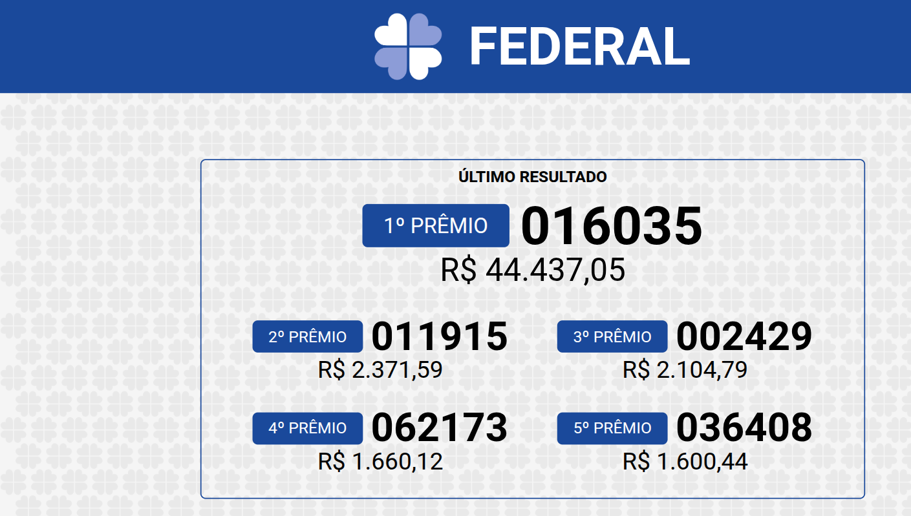 | 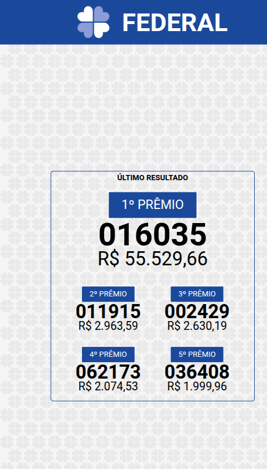 | 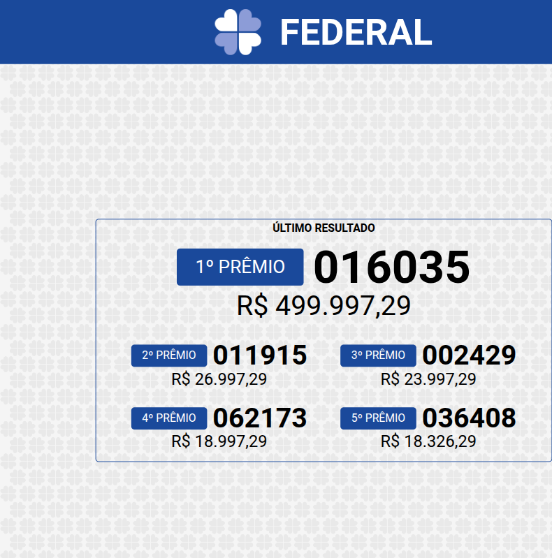 |

| Vertical banner |
|-------------------|
|  |

## Features

Cycles through whichever of the 10 supported games have result data present in the media (`media.iteration` picks which one shows), each with its own layout for landscape/portrait/square/horizontal-banner/vertical-banner screen formats.

All on-screen text is in Brazilian Portuguese by design — this template's entire purpose is displaying official Brazilian federal lottery results to a Brazilian audience, so the game names and labels are not translated to other languages.

## Supported games

Each game has its own layout for every screen format. Below is each one in landscape; the other formats (portrait, square, horizontal banner, vertical banner) are in [docs/screenshots/games/](docs/screenshots/games/). To preview a game locally, set `iteration` in `public/dsplay-data.js` to its position in the cycle (0 = Federal, 1 = Mega-Sena, ... 9 = Loteca).

| Federal | Mega-Sena |
|---|---|
| 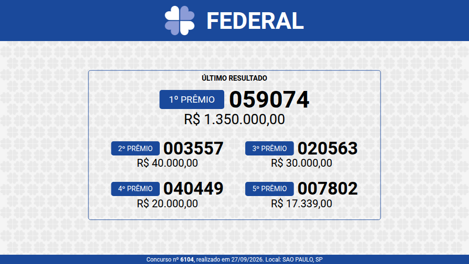 | 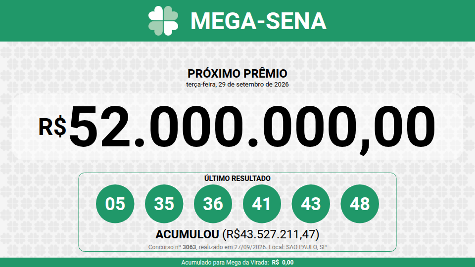 |

| Dupla-Sena | Quina |
|---|---|
| 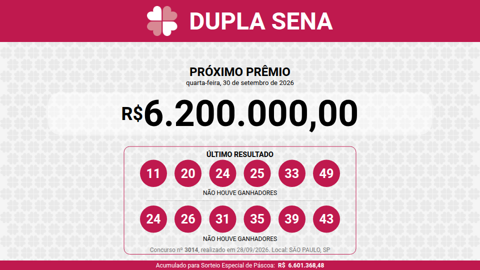 | 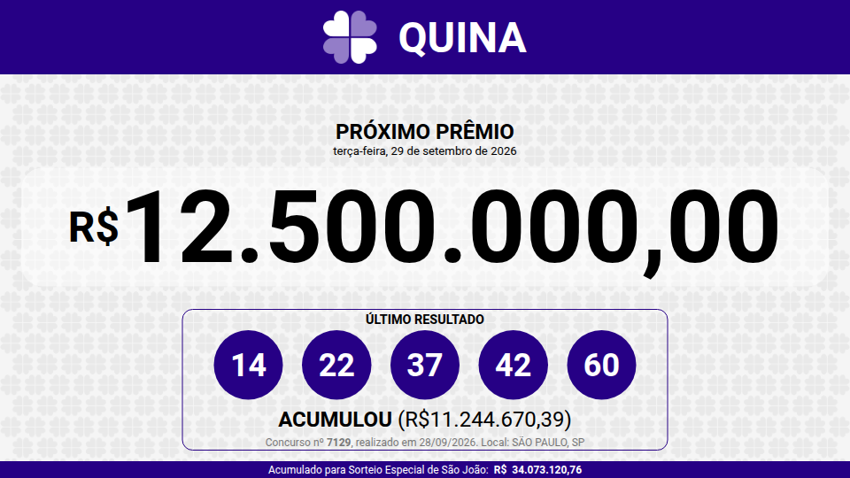 |

| Lotofácil | Lotomania |
|---|---|
| 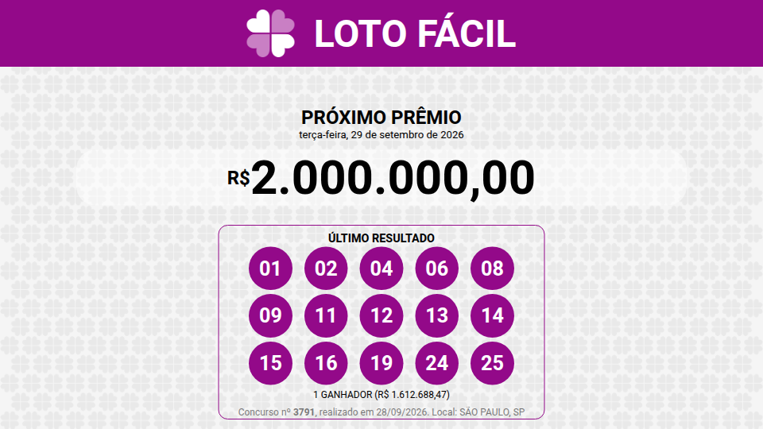 | 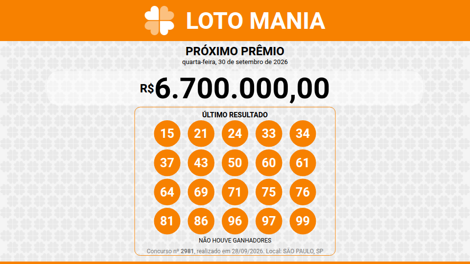 |

| Timemania | Dia de Sorte |
|---|---|
| 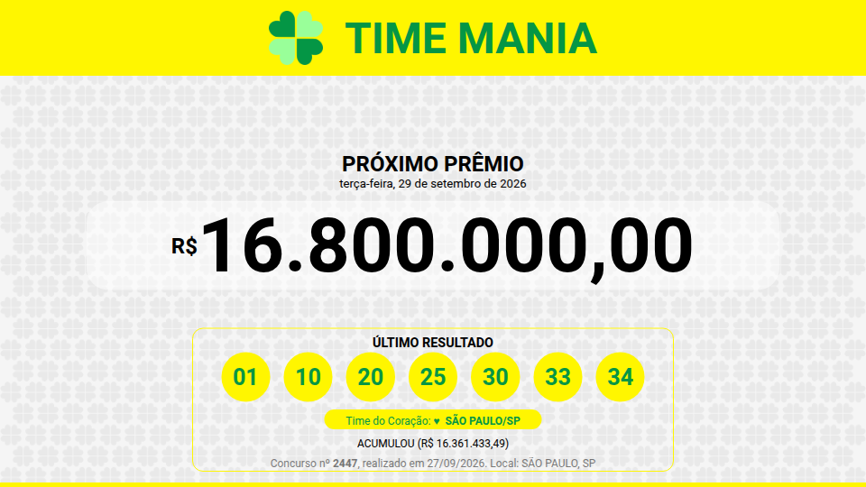 | 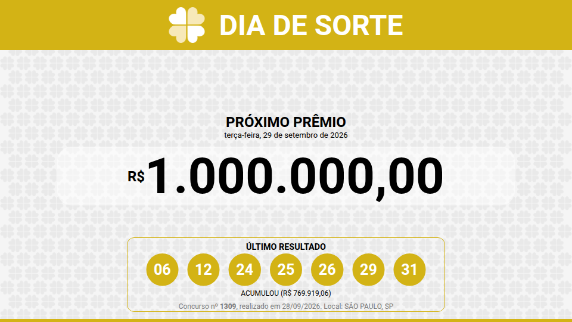 |

| Super Sete | Loteca |
|---|---|
| 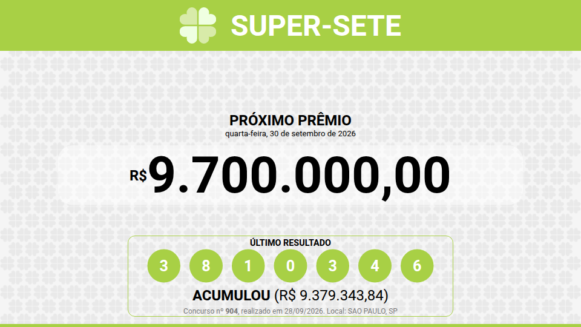 | 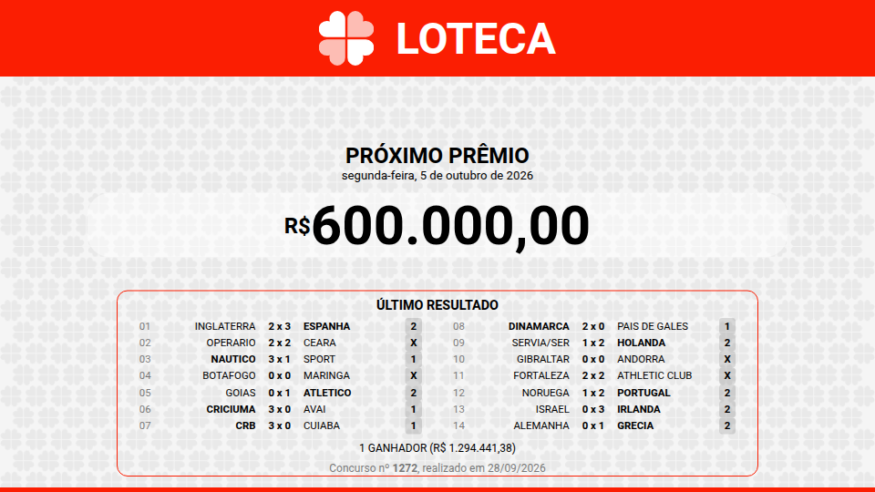 |

## Template variables

This template has no `dsplay_template` variables — everything shown comes from `media.result.data`, a JSON-service payload keyed by game (`federal`, `megasena`, `duplasena`, `quina`, `lotofacil`, `lotomania`, `timemania`, `diadesorte`, `supersete`, `loteca`). See `public/dsplay-data.js` for a full example payload and `src/components/app/index.jsx` for how a game is picked.

## Local development

This template lives in the [dsplay-templates monorepo](https://github.com/dsplay/dsplay-templates/blob/main/README.md): install and run it from the **repository root**. The dev server builds the shared `@dsplay/*` libraries first, which a bare `npm start` inside this folder does not, and `npm install` run inside this folder only installs this template's own packages, not the repository tooling (Turborepo) that does that build.

```sh
npm install                       # once
npm start -- --filter=dsplay-template-lottery-br-caixa-economica-federal
```

`public/dsplay-data.js` defines `dsplay_config`/`dsplay_media`/`dsplay_template` mock globals used only when the template isn't running inside the actual DSPLAY app. Edit `dsplay_media.result.data` to try out different results. The DSPLAY Player App replaces it with real content at runtime.

## Packing (release build)

```sh
npm run zip -- --filter=./templates/lottery-br-caixa-economica-federal   # from the repository root
```

`template.zip` is written to this folder (`templates/lottery-br-caixa-economica-federal/template.zip`). The **Package templates** GitHub workflow builds it too (Actions tab, then download the artifact), so you can get it without a local build.

This builds the template with Vite, which also generates `template-variables.json` + `template-example-data.json` (via [@dsplay/template-manifest](https://www.npmjs.com/package/@dsplay/template-manifest)'s Vite plugin) — the DSPLAY CMS reads these two files to auto-detect this template's variables and seed default preview values (an empty list here, since there are none). It then generates `template.zip`, ready to be deployed to the [DSPLAY Web Manager](https://manager.dsplay.tv/template/create).

## Maintaining dependencies

**Dependencies must always be pinned to an exact version** (never `^`, `~` or any other range). The repository's root [`.npmrc`](https://github.com/dsplay/dsplay-templates/blob/main/.npmrc) sets `save-exact=true`, so `npm install <pkg>@<version>` pins automatically. It also disables dependency install scripts (`ignore-scripts=true`) and only accepts package versions published at least 3 days ago (`min-release-age=3`), to reduce supply chain risk. None of the current dependencies need a post-install build step; if one ever does, add a `setup` script to `package.json` (`npm install && npm rebuild <package>`) and document it here.

[Dependabot](https://github.com/dsplay/dsplay-templates/blob/main/.github/dependabot.yml) proposes updates weekly, waiting 3 days after a release (7 days for major versions) before opening a PR.

```sh
npm outdated                  # from the repository root: what has newer versions available
npm install <dependency>@<version> -w dsplay-template-lottery-br-caixa-economica-federal   # bump a dependency of this template (stays pinned)
```

Since versions are pinned, `npm update` does nothing; bump each package explicitly (or merge Dependabot's PRs). For a major bump, verify `npm start -- --filter=dsplay-template-lottery-br-caixa-economica-federal` and `npx turbo run build test --filter=dsplay-template-lottery-br-caixa-economica-federal` (from the repository root) still work before committing.

### Commit conventions

See [AGENTS.md](AGENTS.md).

## More

To see more about DSPLAY HTML Templates, visit: https://developers.dsplay.tv/docs/html-templates

To work on this template together with the others (shared libraries, creating a new template from an existing one, releases), see the [repository README](https://github.com/dsplay/dsplay-templates/blob/main/README.md).
