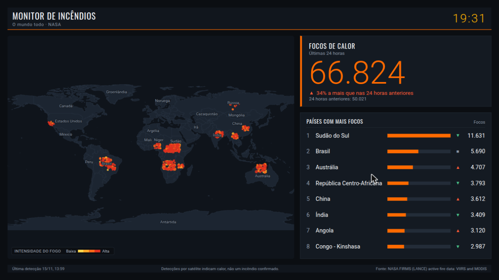
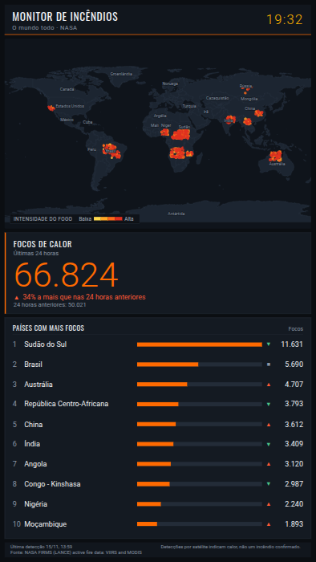
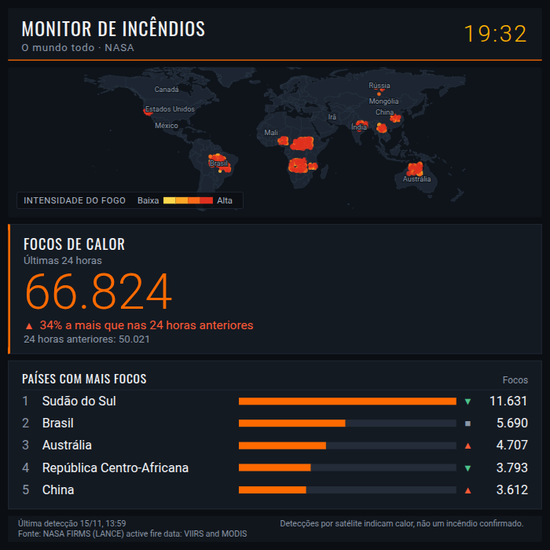
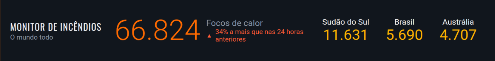
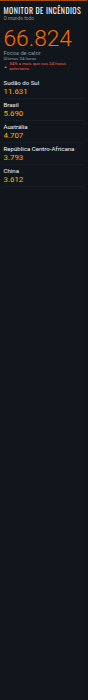

# DSPLAY - Wildfire Monitor Template

A [React](https://reactjs.org/) [HTML-based template](https://developers.dsplay.tv/docs/html-templates) for the [DSPLAY - Digital Signage](https://dsplay.tv/) platform, built for the **Wildfire Monitor** media type: satellite fire detections around a place you choose, for a country, or for the whole world.

It fetches nothing and holds no key: DSPLAY's player gateway answers the media with the `wildfire/1` document (NASA FIRMS data, reduced on the server), the player hands it to the template as `media.result` and fetches it again when it expires. The template only draws it.

> Built with [Vite](https://vitejs.dev/), requires Node.js 22.22.2+, 24.15.0+, or 26+ (see the repository's [`.nvmrc`](https://github.com/dsplay/dsplay-templates/blob/main/.nvmrc)). Only players that speak the gateway protocol play this media type (Android 4.2.0+ and the web-based players).

## Supported screen formats

| Landscape | Portrait | Square |
|-----------|----------|--------|
|  |  |  |

| Horizontal banner | Vertical banner |
|--------------------|-------------------|
|  |  |

> The panels stack on a portrait or square screen (10 ranking rows in portrait, 5 on a square one, which has less height). The two banner formats do not draw the panels: they show the headline number with its trend and the top three (horizontal) or five (vertical) of the ranking.

## What it shows

Nothing is configured here: the place and the area (a radius around it, the country it is in, or the whole world) are the media's own settings in the DSPLAY CMS.

| The answer has | On screen |
|----------------|-----------|
| `summary` | The number of detections in the last 24 hours, the change against the 24 hours before (up, down, same, or none before), and the time of the last detection |
| `regions[]` | The ranking: countries (a radius or the world) or states (a country scope that has them, Brazil today), with a bar and the trend of each row |
| `points[]`, `scope` | The map: the countries' outlines with their names, the area fitted to the box (a country scope shows the whole country) and a small dot per cell, bigger for more detections and coloured by the strongest fire in it (yellow, orange, deep orange, red, with a legend), faint when it has nothing in the last 24 hours. A radius scope also draws its circle and marks the place; Brazil's states are named in a close view |
| `sources[]` | The credit in the footer |

A detection is a satellite hotspot, **not a confirmed fire**; the footer says so. Counts of different sources are never added up.

The map is drawn here from the countries' outlines (Natural Earth, public domain), so it needs no tiles, no key and no connection. The names written on it are the ones that fit at the zoom it has: a world view names its larger countries, a close view the country, its neighbours and Brazil's states (`src/components/fire-map/labels.js`). The names of countries come from the browser in the screen's language; a WebView that cannot give them uses the English table in `src/components/main/country-names.js`.

The template's own text is in English, Portuguese, Spanish, Italian, German and Dutch, picked from the player's language (`dsplay_config.locale`).

## Local development

This template lives in the [dsplay-templates monorepo](https://github.com/dsplay/dsplay-templates/blob/main/README.md); install from the repository root, then:

```sh
npm start
```

`public/dsplay-data.js` defines the `dsplay_config`/`dsplay_media`/`dsplay_template` mock globals used only outside the DSPLAY app; edit `dsplay_media.result` to try other answers (a radius or country scope, a `subdivision` ranking with `BR-xx` codes, no detections). To see any screen size, open `/test-assets/format.html?w=1920&h=1080` (a dev-only harness, left out of the release build).

## For developers

| To change | Edit |
|-----------|------|
| The loader animation (a flame and two sparks, inline SVG) | `src/components/intro` |
| Text and translations (every key is its English text; all six languages must map all keys, a test checks it) | `src/i18n.js` |
| Colours and layout per format | `src/components/main/style.sass` |
| What an answer becomes on screen (trend, names, map bounds, projection) | `src/components/main/model.js` |
| The map | `src/components/fire-map` (the outlines are built by `scripts/build-outlines.mjs`) |

### Test assets

To use test assets (images, videos, etc) during development, put them in the `public/test-assets` folder and reference them in `public/dsplay-data.js`; the folder is excluded from the release build.

### Packing (release build)

```sh
npm run zip
```

Builds with Vite (which also writes `template-variables.json` and `template-example-data.json` through [@dsplay/template-manifest](https://www.npmjs.com/package/@dsplay/template-manifest)'s plugin) and zips the output into `template.zip`, ready to upload to the [DSPLAY Web Manager](https://manager.dsplay.tv/template/create). The template has no variables.

### Maintaining dependencies

Dependencies are pinned to exact versions; see [AGENTS.md](AGENTS.md).

## More

To see more about DSPLAY HTML Templates, visit: https://developers.dsplay.tv/docs/html-templates

To work on this template together with the others (shared libraries, creating a new template from an existing one, releases), see the [repository README](https://github.com/dsplay/dsplay-templates/blob/main/README.md).
