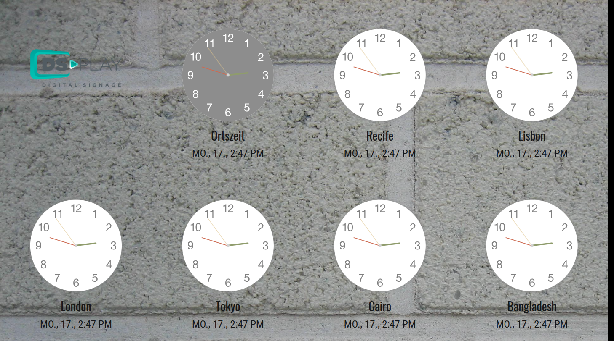
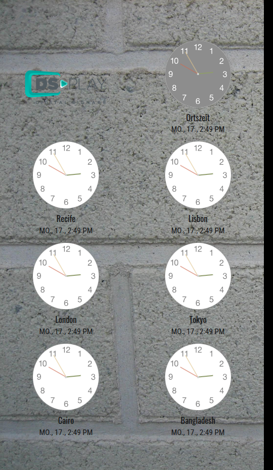
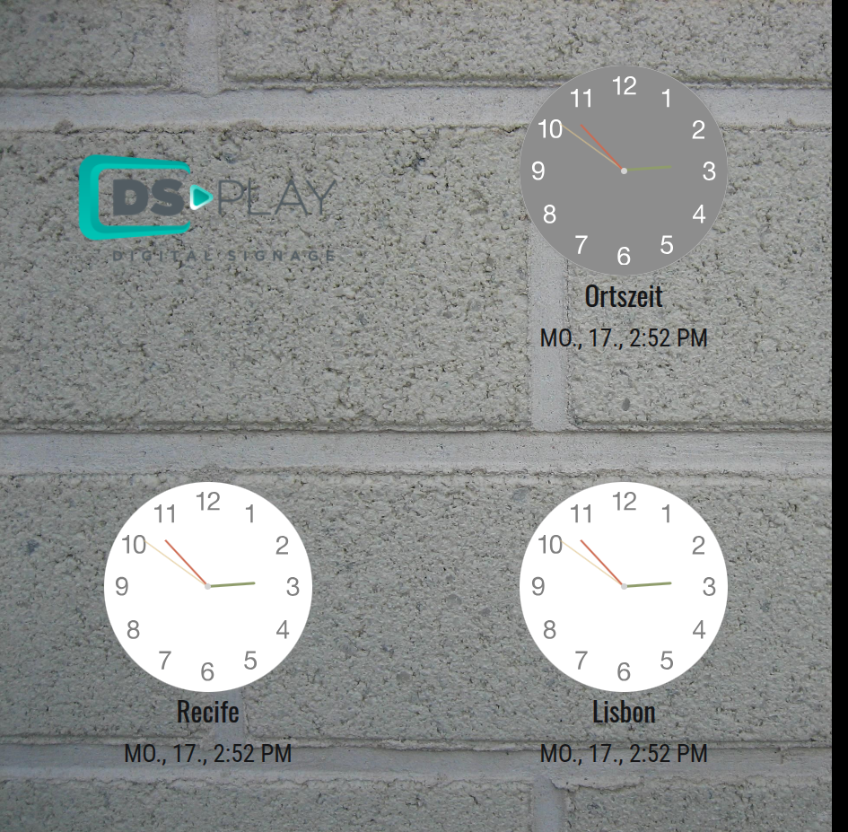
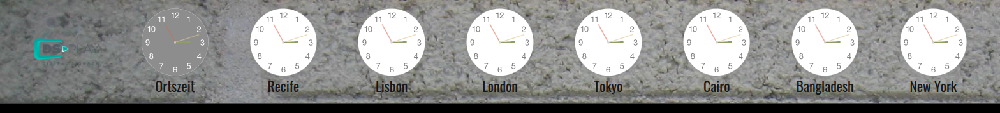
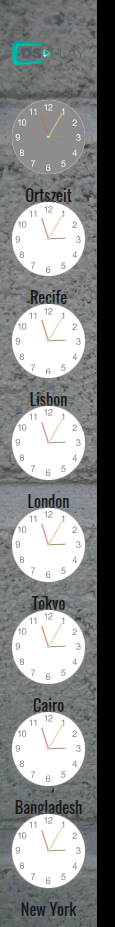

# DSPLAY - World Clocks (analog) Template

A [React](https://reactjs.org/) [HTML-based template](https://developers.dsplay.tv/docs/html-templates) for the [DSPLAY - Digital Signage](https://dsplay.tv/) platform — shows up to 8 analog clocks side by side, each for a configurable city/timezone.

> Built with [Vite](https://vitejs.dev/), requires Node.js 22.22.2+, 24.15.0+, or 26+ (see the repository's [`.nvmrc`](https://github.com/dsplay/dsplay-templates/blob/main/.nvmrc)).

## Supported screen formats

| Landscape | Portrait | Square |
|-----------|----------|--------|
|  |  |  |

| Horizontal banner | Vertical banner |
|--------------------|-------------------|
|  |  |

> The clock count shown adapts per format (`src/components/main/index.jsx`): square drops to 3 clocks (fewer, larger) to stay legible, while the banner formats show one extra clock and hide the date/time text line to fit the reduced height/width.

## Template variables

| Key                 | Type   | Description                                                                                     |
|----------------------|--------|-----------------------------------------------------------------------------------------------|
| `city_1` .. `city_8` | string | City to show a clock for. `Local` shows the viewer's own timezone; otherwise one of: Amsterdam, Asuncion, Berlin, Bogota, Buenos Aires, Cairo, Cape Verde, Chicago, Dubai, Dublin, Hong Kong, Johannesburg, Lima, Lisbon, London, Luxembourg, Madrid, Moscow, New York, Paris, Recife, Rome, São Paulo, Tokyo, Zurich. Leave a slot blank to show fewer than 8 clocks. `city_1` is required. |
| `theme`              | string | Color theme — `light` or `dark`. The code also supports a third value, `sky`, not yet registered in the CMS. |
| `brand`              | string | Optional logo image shown alongside the clocks. Reduces the max number of visible clocks from 8 to 7 (hidden entirely on square screens). |
| `background`         | string | Optional background image.                                                                      |

> Remember to also register these as Template Vars (same name and type) when configuring this template in the DSPLAY CMS.

> New variable names should use `snake_case` (e.g. `background_color`, not `backgroundColor`) — the DSPLAY CMS Manager auto-generates each variable's label from its key, and snake_case reads more naturally there.

## Local development

This template lives in the [dsplay-templates monorepo](https://github.com/dsplay/dsplay-templates/blob/main/README.md): install and run it from the **repository root**. The dev server builds the shared `@dsplay/*` libraries first, which a bare `npm start` inside this folder does not, and `npm install` run inside this folder only installs this template's own packages, not the repository tooling (Turborepo) that does that build.

```sh
npm install                       # once
npm start -- --filter=dsplay-template-world-clocks-analog
```

`public/dsplay-data.js` defines `dsplay_config`/`dsplay_media`/`dsplay_template` mock globals used only when the template isn't running inside the actual DSPLAY app. Edit it to try out different cities/themes — the DSPLAY Player App replaces it with real content at runtime.

## Packing (release build)

```sh
npm run zip -- --filter=./templates/world-clocks-analog   # from the repository root
```

`template.zip` is written to this folder (`templates/world-clocks-analog/template.zip`). The **Package templates** GitHub workflow builds it too (Actions tab, then download the artifact), so you can get it without a local build.

This builds the template with Vite, which also generates `template-variables.json` + `template-example-data.json` (via [@dsplay/template-manifest](https://www.npmjs.com/package/@dsplay/template-manifest)'s Vite plugin) — the DSPLAY CMS reads these two files to auto-detect this template's variables and seed default preview values. Note that `city_1..city_8` aren't detected by the scanner (they're read via a dynamically-constructed key, `` `city_${i + 1}` ``) — they're documented above instead. It then generates `template.zip`, ready to be deployed to the [DSPLAY Web Manager](https://manager.dsplay.tv/template/create).

## Test assets

To use test assets (images, videos, etc) during development, put them in the `public/test-assets` folder and reference them in `dsplay-data.js` using their relative path. `public/test-assets` is automatically excluded from the release build.

## Maintaining dependencies

**Dependencies must always be pinned to an exact version** (never `^`, `~` or any other range). The repository's root [`.npmrc`](https://github.com/dsplay/dsplay-templates/blob/main/.npmrc) sets `save-exact=true`, so `npm install <pkg>@<version>` pins automatically. It also disables dependency install scripts (`ignore-scripts=true`) and only accepts package versions published at least 3 days ago (`min-release-age=3`), to reduce supply chain risk. None of the current dependencies need a post-install build step; if one ever does, add a `setup` script to `package.json` (`npm install && npm rebuild <package>`) and document it here.

[Dependabot](https://github.com/dsplay/dsplay-templates/blob/main/.github/dependabot.yml) proposes updates weekly, waiting 3 days after a release (7 days for major versions) before opening a PR.

```sh
npm outdated                  # from the repository root: what has newer versions available
npm install <dependency>@<version> -w dsplay-template-world-clocks-analog   # bump a dependency of this template (stays pinned)
```

Since versions are pinned, `npm update` does nothing; bump each package explicitly (or merge Dependabot's PRs). For a major bump, verify `npm start -- --filter=dsplay-template-world-clocks-analog` and `npx turbo run build test --filter=dsplay-template-world-clocks-analog` (from the repository root) still work before committing.

### Commit conventions

See [AGENTS.md](AGENTS.md).

## More

To see more about DSPLAY HTML Templates, visit: https://developers.dsplay.tv/docs/html-templates

To work on this template together with the others (shared libraries, creating a new template from an existing one, releases), see the [repository README](https://github.com/dsplay/dsplay-templates/blob/main/README.md).
